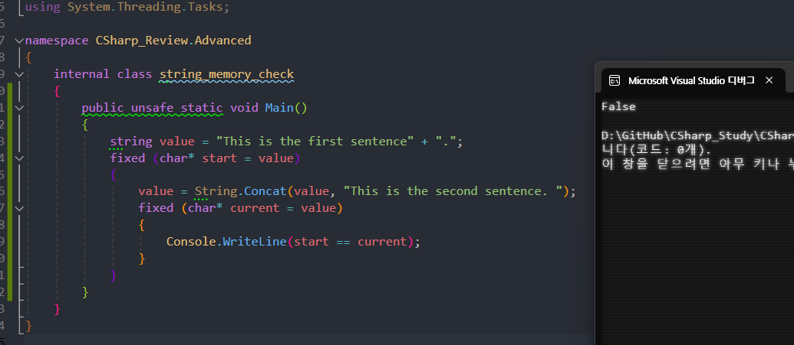

---

### String과 StringBuilder

---

우선, 둘 다 문자열을 다루는 클래스이다.  
하지만 그 용도가 다르다.

String은 문자열을 **'표현'**하는 용도로 자주 사용되고,  
StringBuilder는 문자열을 **'조작'**하는 용도로 사용된다.

다시 말해

String은 **'불변성'**을 가지고,  
StringBuilder는 **'가변성'**을 가진다.

### String

---

[.Net / System.String 클래스](https://learn.microsoft.com/ko-kr/dotnet/fundamentals/runtime-libraries/system-string)

기본적으로 String은 **변경할 수 없는 형식**이다.  
즉, 개체(객체)를 수정하는 것처럼 보이는 작업은 실제로 새로운 문자열을 만드는 작업이다.  
그에 대한 예제는 아래의 사진을 보면 확인할 수 있다.

{: .align-center}
*start에 할당된 주소와 current에 할당된 주소가 다른 것을 확인할 수 있다*

String.Concat() 함수는 기존의 문자열 뒤에 새로운 문자열을 이어 붙이는 함수인데,  
이 과정에서 생성된 새로운 문자열은 새로운 메모리 주소를 가진 개체를 반환한다.

[cf) unsafe 키워드 사용하기](https://z-man.tistory.com/170)

이러한 이유로, String 클래스는 문자열을 '조작'하는 작업에는 성능 저하를 발생시키는데,  
대안으로는 문자열 변경이 가능한 **StringBuilder 클래스**를 사용하는 것이다.

#### String 클래스를 사용하기 좋은 경우

1. **문자열 조작의 횟수가 작은 경우**, 초기화 비용이 큰 StringBuilder를 사용하기보다는 String을 사용한다.
2. **문자열 내에서 검색 작업(IndexOf로 요소에 접근)이 많은 경우**는 StringBuilder의 개체를 String 개체로 변경해야 하므로 String을 사용한다.

### StringBuilder 작동 방식

---

[.Net / System.Text.StringBuilder 클래스](https://learn.microsoft.com/ko-kr/dotnet/fundamentals/runtime-libraries/system-text-stringbuilder)

StringBuilder 클래스는 문자열을 동적으로 변경할 수 있게 해주는 **가변적인** 문자열 타입으로,  
빈번한 문자열 조작을 최적화하기 위해 설계되었다.

StringBuilder는 내부적으로 문자열을 처리하기 위한 **동적 배열**을 사용한다.  
StringBuilder 개체에 문자를 추가하면, StringBuilder.Capacity 크기와 같을 때까지 길이가 증가한다.  
**그 크기를 초과하게 되면 새 메모리가 할당**되고, Capacity가 두 배로 늘어난다.  
이후 새로운 문자열이 StringBuilder 개체에 추가되며, 이러한 동적 할당은 StringBuilder.MaxCapacity값에 도달할 때까지 반복된다.

{: .align-center}
*StringBuilder의 기본 용량은 16자*

#### String 클래스를 사용하기 좋은 경우

1. **프로그램이 실행될 때까지 프로그램이 처리해야 할 문자열의 개수를 미리 알 수 없는 상황**  
(ex : 루프를 사용하여 사용자 입력이 포함된 난수의 문자열을 연결할 때)
1. **문자열을 상당히 많이 변경할 것으로 예상되는 경우**

### 문자열 조작이 많은 상황에서 String과 StringBuilder의 성능차이

---

```cs
// string vs stringBuilder
// 문자열 연산 시 속도 비교

// static은 정적 메서드 사용 시 선언하는데
// 클래스의 인스턴스 생성없이 메서드를 클래스 딴에서 호출할 수 있다.
static int Main()
{
    string str = "Hello";
    DateTime strStartTime = DateTime.Now;

    for (int i = 0; i < 100000; i++)
    {
        // String의 += 연산자는 문자열 조작 시, 새로운 메모리를 할당받는다. 따라서 문자열 조작에 큰 비용이 든다.
        str += " World";
    }

    DateTime strEndTime = DateTime.Now;
    TimeSpan strDuration = strEndTime - strStartTime;
    Console.WriteLine(string.Format($"String Duration: {strDuration.TotalMilliseconds} ms"));

    StringBuilder sb = new StringBuilder("Hello");
    DateTime sbStartTime = DateTime.Now;

    for (int i = 0; i < 100000; i++)
    {
        // StringBuilder의 Append() 함수는 문자열 조작 시, 새로운 개체가 아닌 원본의 동적 배열로 이루어진 문자열의 크기를 늘리므로써 조작하기 때문에 비용이 적다.
        sb.Append(" World");
    }

    DateTime sbEndTime = DateTime.Now;
    TimeSpan sbEndTimeDuration = sbEndTime - sbStartTime;
    Console.WriteLine(string.Format($"StringBuilder Duration: {sbEndTimeDuration.TotalMilliseconds} ms"));

    return 0;
}
```

{: .align-center}
*문자열 조작 연산이 10만번 있을 때, String과 StringBuilder의 성능 차이*