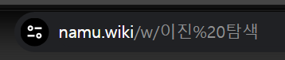
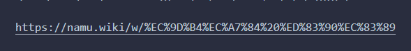

---

### 웹 브라우저의 URL

---

웹 브라우저의 URL을 주소창에서 복사한 다음 붙여넣기 하는 상황이 있었다.  
(이진 탐색의 나무위키 설명을 보고 있었다..ㅎ)

{: .align-center}
*변환되기 전의 URL*

사용자가 웹 브라우저의 주소창에 URL을 입력하거나 웹 페이지 내의 링크를 클릭할 때,  
해당 텍스트는 사용자가 이해하고 읽을 수 있는 자연스러운 언어 형태로 존재한다.  
즉 __문자열로 존재한다.__

### 웹 서버로 전송되는 URL

---

평소에는 생각없이 복사한 URL을 붙여넣고 끝! 하고 말지만,  
우연히 붙여넣기 된 URL을 봤는데 다음과 같이 바뀌어 있었다.

{: .align-center}
*변환된 후의 URL*

URL이 __웹 서버에 전송되기 전에 UTF-8 인코딩 과정을 거치게 된 것이다.__

16진수 UTF-8로 인코딩된 __https://namu.wiki/w/%EC%9D%B4%EC%A7%84%20%ED%83%90%EC%83%89__ 의 내용을 살펴보면 다음과 같다.

* __%EC%9D%B4%EC%A7%84%__ : "이진"
* __%20__ : ' ' (공백)
* __%ED%83%90%EC%83%89__ : "탐색"
