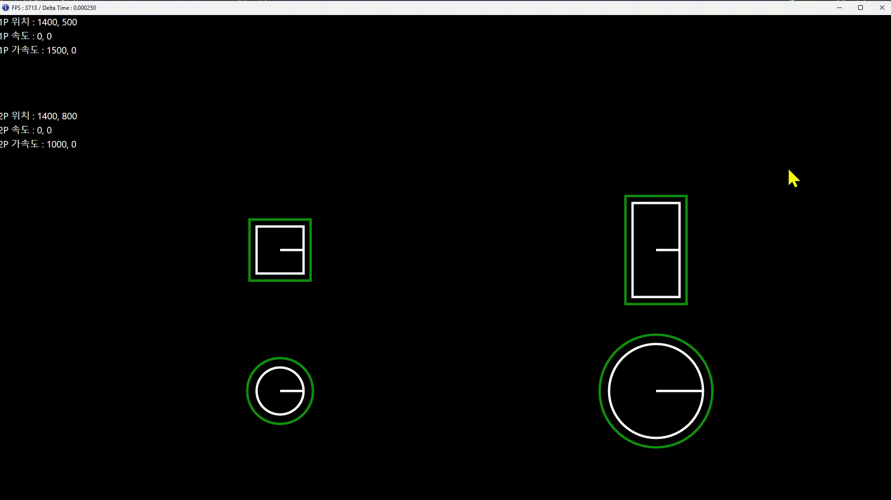

---

{: .align-center}

물체의 이동과 충돌을 구현하면서 X Y 동시 이동을 하는 과정에서  
Velocity에 deltaTime을  실수로 두 번 곱해줘서 잠시 애먹었지만 다행히 잘 캐치해서 버그를 해결했다.

요즘 DirectX 2D를 공부 중이다. 2D 플랫포머나 탑뷰 게임으로 프로젝트를 진행할 예정인데,  
이를 위한 물리 기능을 중점으로 공부를 할 것 같다.

최근 공부한 내용으로는 AABB, CC, OBB(구현 중), AABB - CC 간의 충돌, Position, Velocity, Acceleration ... 등등  
Rigidbody Component와 PlayerMovement Component를 중점으로 기능 구현 중이다.

앞으로는 Impulse Resolution, Gravity, Jump ... 등등의 물리 법칙을 구현할 예정이다.
