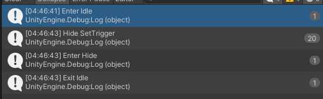
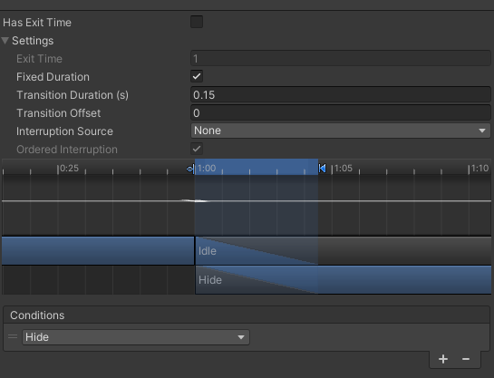
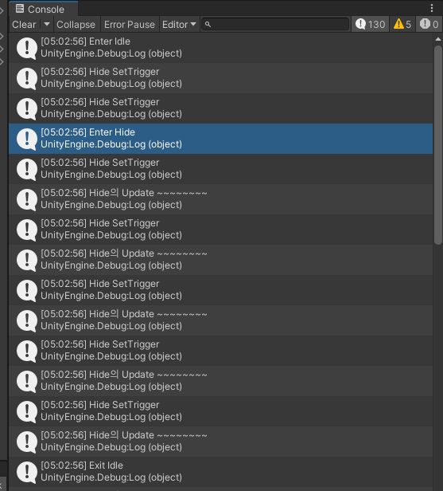
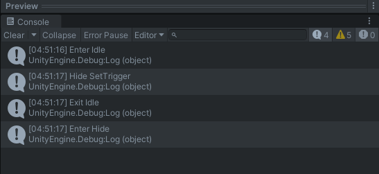
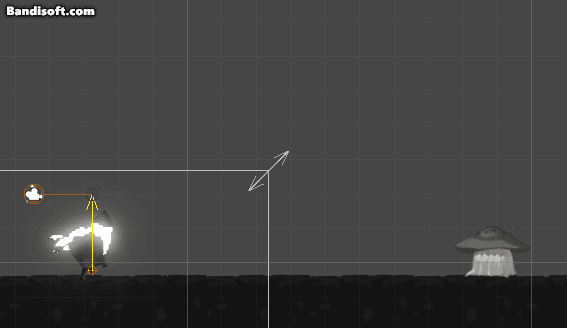
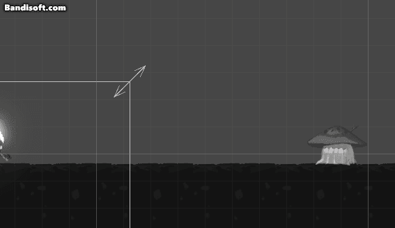

---

### 의도치 않은 동작 발생

---

몬스터 애니메이터를 만지다가 원치 않은 동작이 발생한다.

.gif){: .align-center}

영역 밖으로 나가면 나오고, 들어오면 숨는 그런 기능을 만드려고 했는데  
애니메이션이 부자연스럽게 전이가 된다.  
(원래는 슝~ 하고 들어갔다 나왔다가 해야 함)

왜 그런지 이유를 찾다 보니  
애니메이션 전이를 위해 해주고 있던 파라미터의 SetTrigger()가 한 번이 아닌 여러 번 호출되고 있었다.

{: .align-center}

### 참고 : 상태 머신 동작 (StateMachineBehavior)

---

내가 진행하고 있는 유니티 프로젝트에서는 유니티에서 제공하는 StateMachineBehavior를 이용해 FSM을 설계한다.

[상태 머신 동작 - Unity 3D Docs](https://docs.unity3d.com/kr/560/Manual/StateMachineBehaviours.html)  
[생명주기에서의 상태 머신- Unity 3D Docs](https://docs.unity3d.com/kr/current/Manual/ExecutionOrder.html#AnimationUpdateLoop:~:text=StateMachineBehaviour%20(OnStateEnter/OnStateUpdate/OnStateExit)%3A%20%EB%A0%88%EC%9D%B4%EC%96%B4%EA%B0%80%20%EC%B5%9C%EB%8C%80%203%EA%B0%9C%EC%9D%98%20%ED%99%9C%EC%84%B1%20%EC%83%81%ED%83%9C(%ED%98%84%EC%9E%AC%20%EC%83%81%ED%83%9C%2C%20%EC%A4%91%EB%8B%A8%EB%90%9C%20%EC%83%81%ED%83%9C%2C%20%EB%8B%A4%EC%9D%8C%20%EC%83%81%ED%83%9C)%EB%A5%BC%20%EA%B0%80%EC%A7%88%20%EC%88%98%20%EC%9E%88%EC%8A%B5%EB%8B%88%EB%8B%A4.%20%EC%9D%B4%20%ED%95%A8%EC%88%98%EB%8A%94%20OnStateEnter%2C%20OnStateUpdate%20%EB%98%90%EB%8A%94%20OnStateExit%20%EC%BD%9C%EB%B0%B1%EC%9D%84%20%EC%A0%95%EC%9D%98%ED%95%98%EB%8A%94%20StateMachineBehaviour%20%EC%BB%B4%ED%8F%AC%EB%84%8C%ED%8A%B8%EA%B0%80%20%ED%8F%AC%ED%95%A8%EB%90%9C%20%EA%B0%81%20%ED%99%9C%EC%84%B1%20%EC%83%81%ED%83%9C%EC%97%90%20%EB%8C%80%ED%95%B4%20%ED%98%B8%EC%B6%9C%EB%90%A9%EB%8B%88%EB%8B%A4.)

### 해결 방법

---

Idle State의 StateMachineBehaviour은 대충 이렇게 생겼다.  
(근데 왜 Behaviour? Behavior 아닌가?)

(프로젝트의 코드가 아닌 임시 코드)

```c#
using UnityEngine;

public class IdleState : StateMachineBehaviour
{
    [SerializeField] private LayerMask _targetLayer;
    private BoxCollider2D _detectBoxCollider;

    override public void OnStateEnter(Animator animator, AnimatorStateInfo stateInfo, int layerIndex)
    {
        _detectBoxCollider = animator.GetComponent<BoxCollider2D>();
    }

    override public void OnStateUpdate(Animator animator, AnimatorStateInfo stateInfo, int layerIndex)
    {
        Collider2D rayHit = Physics2D.OverlapBox(_detectBoxCollider.transform.position,
            _detectBoxCollider.bounds.size, 0f, _targetLayer);

        if (rayHit)
        {
            Debug.Log("SetTrigger Hide");
            animator.SetTrigger("Hide");
        }
    }

    override public void OnStateExit(Animator animator, AnimatorStateInfo stateInfo, int layerIndex)
    {

    }
}
```

내 프로젝트에서도 위 코드와 마찬가지로 OnStateUpdate()에서 `SetTrigger("Hide")`를 통해 애니메이션을 전이시키는데  
분명 유니티의 생명주기 상 한 번만 호출되어야 할 SetTrigger()가 왜 여러 번 호출되지 생각하던 찰나에 떠오른 것이  
`Transition Duration`이었다.

{: .align-center}

Idle 애니메이션이 Hide 애니메이션으로 전이되는 과정에서  
Idle 애니메이션이 끝나고 난 이후에도 0.15초 동안 Hide 애니메이션과 함께 재생되는 것으로 간주하기 때문에  
위와같은 문제가 발생한 것이었다.

{: .align-center}

이 현상의 로그를 찍어 확인해 보면  

1. `Enter Idle` - Idle 애니메이션 시작
2. `Hide SetTrigger` - Hide 애니메이션으로 전이
3. `Enter Hide` - Hide 애니메이션 시작
4. `Hide SetTrigger`와 `Hide의 Update ~~~~~~~` - Idle과 Hide 애니메이션이 동시에 실행
5. `Exit Idle` - Idle 애니메이션 종료 (0.15초 경과)

이렇게 Idle 애니메이션, Hide 애니메이션이 동시에 실행되면서  
애니메이션에 종속적인 `StateMachineBehaviour(Idle State와 Hide State 스크립트)`가 Idle, Hide에서 둘 다 실행되면서 발생한 문제였다.

{: .align-center}

만약 `Transition Duration을` 0으로 맞춘다면, 위와 같이  
애니메이션이 동시에 실행될 일이 없기 때문에 한 번의 `SetTrigger("Hide")`가 실행된다.

### 프로젝트의 해결 방안

---

{: .align-center}

`Transition Duration`을 0.15초였을 때는 애니메이션이 자연스럽게 보간 되어 전이됐는데  
이제 0초로 하면 툭툭 끊기듯이 애니메이션이 전이된다.

이 문제는 어떻게 해결할 것인가..?

```c#
    protected override void Update()
    {
        base.Update();

        if (CautionEvaluator)
        {
            if (!CautionEvaluator.IsTargetWithinCautionRange())
            {
                if (CurrentStateIs<Monster_HideState>())
                {
                    Debug.Log("SetTrigger Idle");

                    Animator.SetTrigger("Idle");
                    return;
                }
            }
            else
            {
                if (CurrentStateIs<Monster_IdleState>())
                {
                    Debug.Log("SetTrigger Hide");

                    Animator.SetTrigger("Hide");
                    return;
                }
            }
        }
    }
```

각각의 State가 아닌 Monobehavior의 Update()에서 `CurrentStateIs<>()`로 현재 상태 체크 후 `SetTrigger()` 해준다.

{: .align-center}

이제 자연스럽게 잘 동작하는 것을 볼 수 있다.
