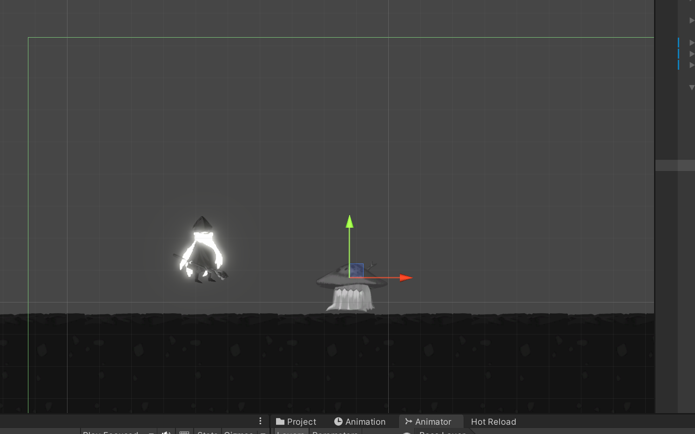
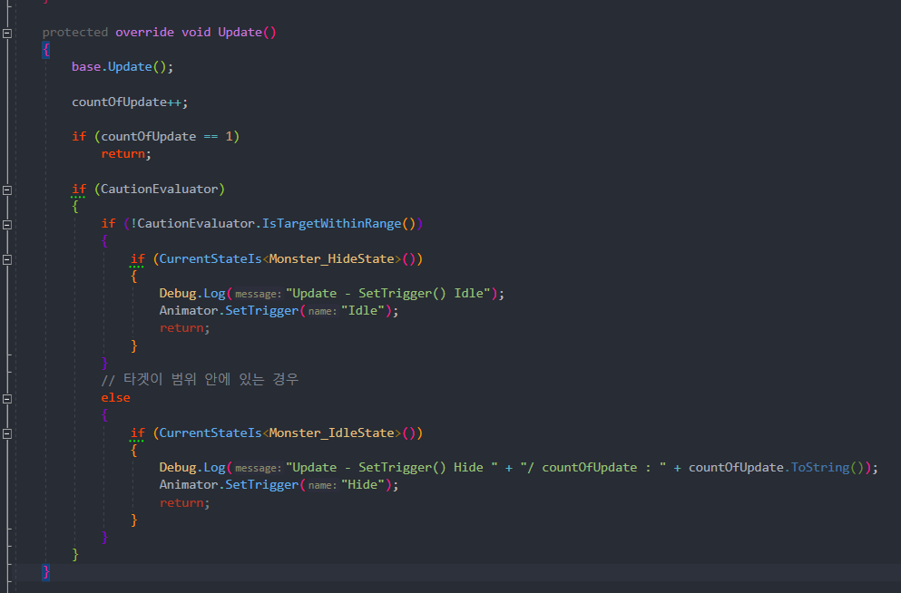
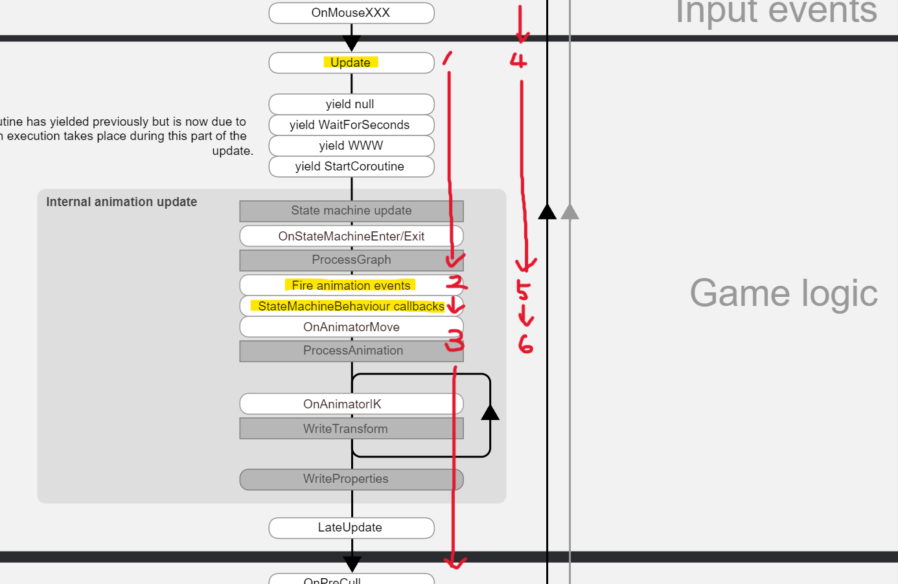
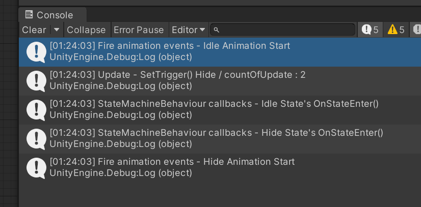

---

### 유니티의 생명주기

---

[Unity Life Cycle](https://docs.unity3d.com/kr/2022.3/Manual/ExecutionOrder.html)

유니티의 여러 이벤트 함수의 호출 순서를 정리해 둔 문서이다.  
그중에서 우리가 오늘 살펴볼 것은 `Update`, `Fire animation events`, `StateMachineBehaviour callbacks`에 대한 내용이다.

.png){: .align-center}{: width="70%" height="70%"}

### 실험 환경

---

{: .align-center}{: width="50%" height="50%"}
*일정 범위 안에 타겟이 들어와있는 상태. 왼쪽은 타겟. 오른쪽은 몬스터*

.png){: .align-center}{: width="70%" height="70%"}
*몬스터의 Entry 상태는 Idle, Idle과 Hide 두 상태로 구성*

 

* **Update** : 다들 흔히 아는 MonoBehavior의 Update()
  {: .align-center}{: width="50%" height="50%"}
  *일정 범위 안에 들어오면 숨는 애니메이션을 재생시키는 코드*
  유니티 생명주기 상, Idle이 되기 전에 `Update()`에서 `SetTrigger()`를 호출해  
  Hide로의 전이가 두번 실행되기 때문에 첫 프레임은 막아준다.

 

* **Fire animation events** : 애니메이션 클립에 등록해 둔 애니메이션 이벤트가 실행되면 호출된다. 
  애니메이션의 첫 프레임에 넣어두었기 때문에, 애니메이션에 진입하자마자 이벤트가 발생한다.
  .png){: .align-center}{: width="70%" height="70%"}
  *Idle과 Hide 애니메이션의 첫 프레임에서 Animation Event 호출*

 

* **StateMachineBehaviour callbacks** : 유니티에서 제공하는 애니메이터 종속 FSM 모델?  
  (SMB의 콜백함수에는 `OnStateEnter()` 이외에도 `OnStateUpdate()`, `OnStateExit()`, 등이 있다.)
  .png){: .align-center}{: width="70%" height="70%"}
  *애니메이터에서 해당 애니메이션 상태에 진입하면 호출되는 콜백함수*

### 실험 결과

---

{: .align-center}{: width="70%" height="70%"}
*유니티 생명주기*

**Update -> Fire animation events -> StateMachineBehaviour callbacks**  
이 순서로 호출되어야 한다.

1. 첫 프레임 Update()를 스킵
2. Idle 애니메이션 이벤트가 발생 (Idle 진입)
3. Idle 상태에 대한 SMB 콜백 함수 OnStateEnter() 실행
4. 두번째 프레임의 Update()에서 SetTrigger("Hide")
5. Hide 애니메이션 이벤트가 발생 (Hide 진입)
6. Hide 상태에 대한 SMB 콜백 함수 OnStateEnter() 실행

그런데 결과는 달랐다.

{: .align-center}{: width="50%" height="50%"}
*Debug.Log()로 이벤트 함수 호출 순서를 찍어본 결과*

왜 Idle Animation Start 다음에 SMB의 OnStateEnter()를 뛰어넘고 Update()로 갔는지 모르겠다.
