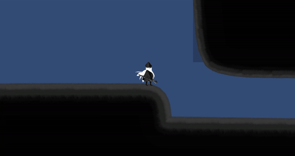
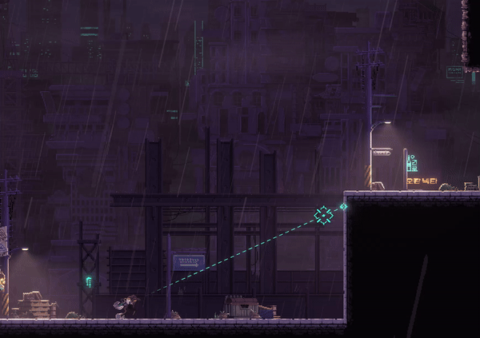

---

{: .align-center}
*벽을 오르다가 더이상 벽이 탐지되지 않을 때의 문제 해결*

현재 진행중인 프로젝트 ASH에서 플레이어의 벽타기 기능을 구현하고 있는데 한 가지 해결해야할 문제가 있었다.  
플레이어가 벽 탐지를 마치고 난 후, 더이상 벽이 탐지되지 않을 때는 어떻게 해야할지에 관한 것이다.

벽이 끝나고 Wall State -> In Air State로 넘어가면 다시 중력에 의해 In Air State -> Wall State로  
두 상태가 반복되면서 버벅이는 문제가 있었는데 영상과 마찬가지로 Jump를 주면 해결되는 문제였다.

{: .align-center}
*산나비의 벽 끝난 후 처리*

별거 아닌 것 같지만, 나는 이 생각을 하지 못하고 있었고 내가 최근에 즐겨하던 산나비 게임을 하다가 우연히 발견한 경우였다.  
게임 프로그래머가 게임을 꾸준히 해야하는 이유일까..?
