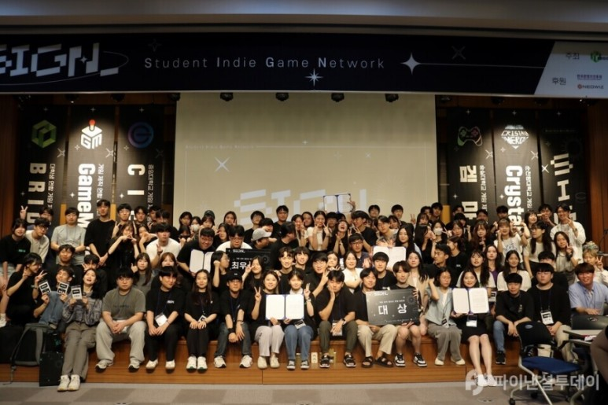
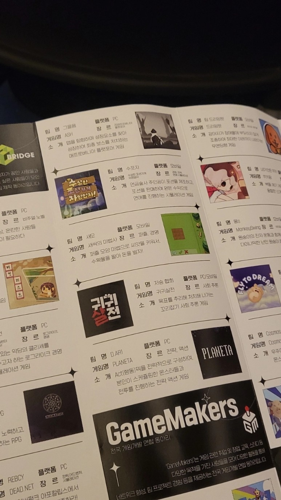
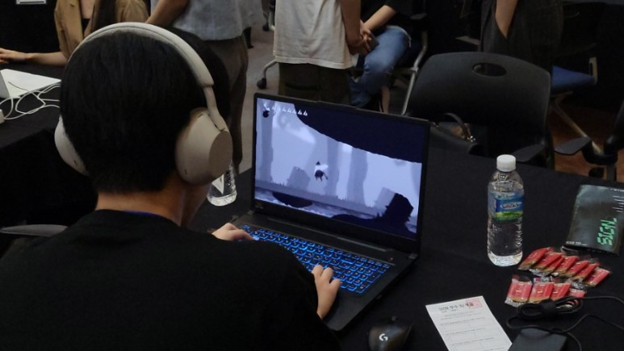
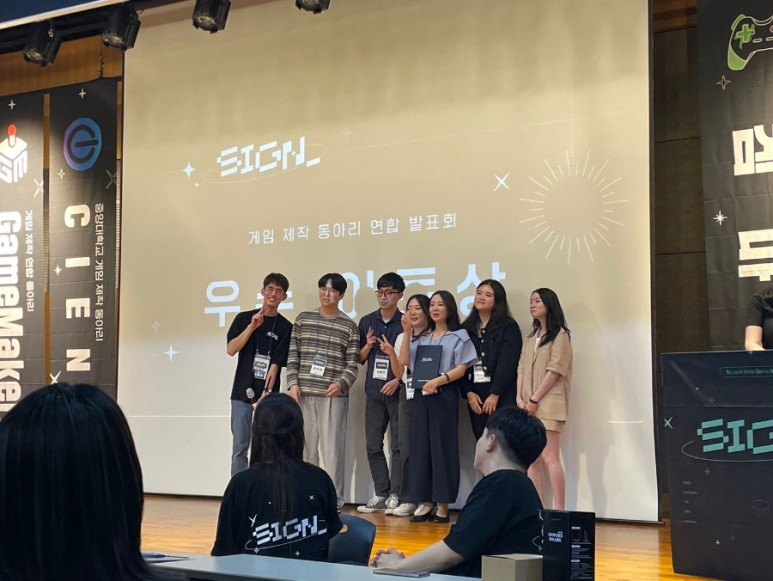
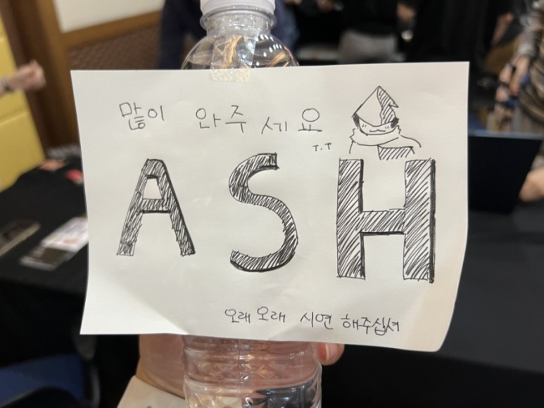
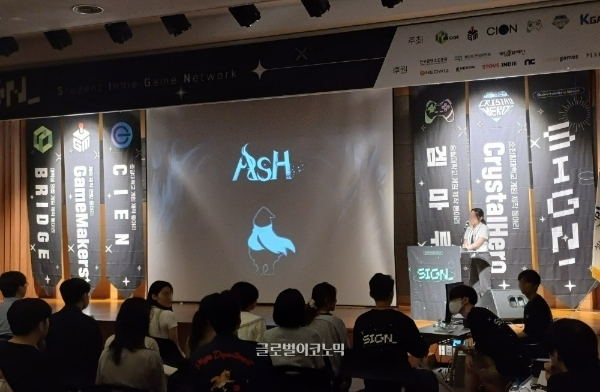

---

{: .align-center}

Bridge의 동아리원으로서 대학생 연합 발표회 SIGN을 다녀왔다.  
총 29개의 게임의 발표와 시연이 있었는데, 제작 중이거나 완성된 게임이 같이 있었다.  
다양한 장르의 게임, 다양한 동아리와 사람들, 등 좋은 기회와 경험이었다.

{: .align-center}

사실 우리 팀(그을음)은 이번에 시연회에 참여할 생각이 없었다.  
왜냐하면 개발 진행이 많이 이루어지지 않은 상태였기 때문이다.  
그런데 참여에 의의를 두자고 참여를 하기로 했는데, 막상 시연회에 참여한다고 하니까 다들 엄청 열심히 하게 되었다.  
그래서 한 달 정도 되는 기간을 크런치 모드로 개발했는데 이 기간에 개발이 많이 이루어졌다.  
버그도 많고 우여곡절이 많았지만 며칠 밤을 새워서 버그도 다 잡고 개발 진행도 많이 된 상태로 심지어 발표회 시작 직전까지도 버그를 고치는 우리 팀이었다.

{: .align-center}

시연회 중 기획, 아트, 프로그래밍, 사운드 직군 모두가 칭찬받았고 그 과정에서 자신감을 많이 얻었다.  
또 거기에서 그치지 않고 대단한 게임이 많은 그 행사 속에서 우리 게임 ASH가 아트 부문 상을 받기도 하였다.  
이날은 뭔가 그동안 열심히 해온 과정에 대한 보상을 받는 느낌이었고 뭔가 잘 풀리는 날이었다고 생각한다.

특히 나는 플레이어 움직임과 스킬 관련해서 작업을 맡았는데,  
중간에 다른 게임 개발자분이 오셔서 어떻게 이렇게 자연스러운 움직임을 구현하셨냐고 여쭤보셨다.  
플레이어 이동 구현에 정말 많은 시간을 썼는데 뿌듯하다.

{: .align-center}

이날 이 행사에 관한 내용들이 많은 기사들로 나오고 그 내용에는 우리 팀도 껴있었다.  
정말 이 행사에 참여하지 않았으면 엄청 후회했을 것 같다.

{: .align-center}

다른 팀들은 홍보를 위해 굿즈같이 준비해온 것들이 많았는데 우리 팀은 그런 걸 준비하지 않아서 즉석에서 이렇게 손수로 만들었다,,

{: .align-center}

프로젝트 발표회 중 ASH 게임의 발표 사진이다.