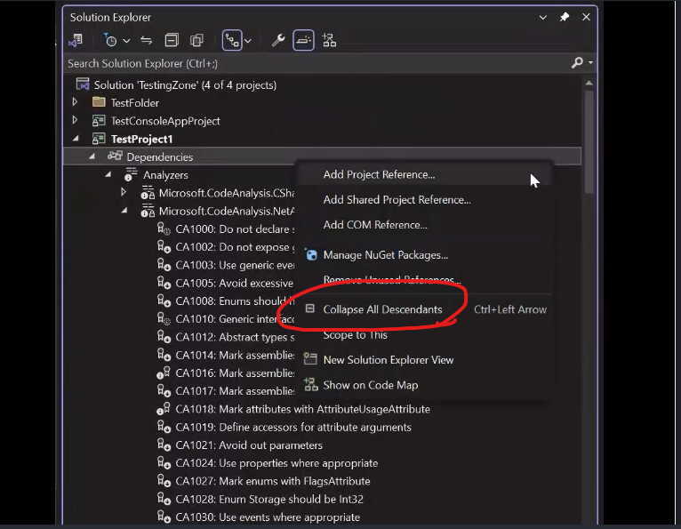
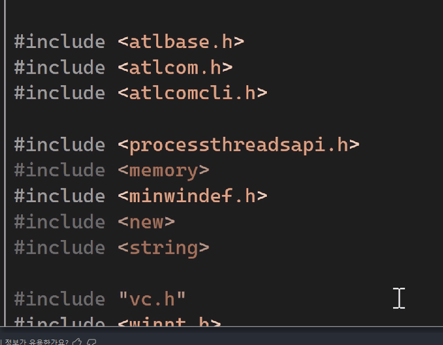

---

### Visual Studio 2022 신규 기능

---

Visual Studio 2022 17.7 버전 최신 업데이트를 받았다.  
평소에 새로운 기능에 대한 탭을 잘 보지 않는 편인데, 오늘따라 보고 싶었다.  
하나씩 읽어보는데 나를 놀라게 한 한 가지 기능이 있었다.  
그것은 바로 솔루션 탐색기의 필터의 모든 하위 항목 축소 기능이다.

{: .align-center}

평소에 필터 정리를 좋아하고 내가 보고 싶은 필터의 내용물만 보는 것을 선호하는데,  
그러기 위해서는 필터를 자주 타고 타고 축소하고 은근히 귀찮은 반복작업이었다.  
그런데 딱 Collapse All Descendants 기능이 생겨버린 것이 아닌가..! 너무 감격스러웠다.  
항상 왜 이 기능은 없을까.. 하면서 손으로 일일이 작업했었는데  
드디어 이 기능을 만들어주다니 사랑합니다 마소..

이번 일로 Visual Studio든 뭐든 업데이트가 되면 새로운 기능을 읽어보는 습관을 가져야겠다고 생각했다.  
최신 업데이트와 트렌드를 따라가는 것은 개발자의 숙명이니까.

### 발전하는 Visual Studio 기본 스펙

---

참고로 새롭게 추가된 기능을 하나더 살펴보자면

{: .align-center}

#include <memory> 같은 경우 사용하지 않고 있어 어둡게 표시되는데,  
이 기능은 원래 Resharper로 사용하고 있다가 정식으로 Visual Studio에도 도입된 모양이다.  
점점 기본 스펙이 발전해 나가는 Visual Studio.. 웅장하다!